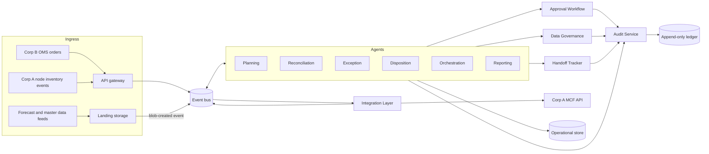

# Logistics Control Tower: Architecture (Azure first, multi-cloud ready)

Status: draft v0.2 (2026-10-05). Source: `# Requirements Document Agentic Fulfillment Orchestration system.md` (R1 to R11).

Naming: the system is the **Logistics Control Tower** (Python package `tower`). "MCF" now means only Corp A's Multi-Channel Fulfillment API that the tower calls. Deployed names keep their old spelling on purpose, so nothing is rebuilt: Azure resources `mcfpilot-*`, the `MCF_*` environment variables, the Cosmos database `mcf`, the SQL database `mcf-audit`, App Configuration keys `mcf:*`, and the `mcf-agents` image.

## 1. Design principles

1. **Cloud-agnostic core, cloud-specific adapters.** All agent and service logic lives in `tower/core`, `tower/services` and `tower/agents` and depends only on *ports* (Python protocols) in `tower/core/ports.py`. Azure is the first set of adapters (`tower/adapters/azure`). GCP and AWS become sibling packages (`tower/adapters/gcp`, `tower/adapters/aws`) with no change to agent code. An in-memory adapter set (`tower/adapters/memory`) runs the whole system locally and in tests.
2. **Event-driven agents.** Agents never call each other directly. They publish and subscribe to typed events on a message bus (topics below). That gives the R3.6 / R5.5 / R4.8 handoffs durability, retries and replay for free.
3. **Deterministic first, LLM where judgement helps.** SLA timers, thresholds, state machines, retries and approvals are deterministic code, because the requirements are timing and correctness contracts. The LLM is used for exception classification with confidence (R3.1, R3.4), decision rationale text (R8.1, R10.1), anomaly narratives and review summaries (R6.3, R6.5). The LLM is itself a port, so a rule-based fallback always exists.
4. **Every decision is audited.** Agents write to the Audit_Service through one helper; a failed write is preserved for replay and alerts the operations team (R10.6).
5. **Guardrails are services, not conventions.** Approval gating (R8), data isolation and PII masking (R9), and Owning_Party attribution (R11) are enforced in shared services that agents must call; agents get no raw handle to restricted stores.

## 2. Logical architecture



### Event topics (cloud-neutral names)

| Topic | Producers | Consumers | Requirement |
|---|---|---|---|
| `orders.received` | OMS ingress | Orchestration | R5.1 |
| `orders.lifecycle` | Integration (MCF status/tracking poll) | Orchestration, Reporting | R5.3, R5.6 |
| `feeds.forecast` | Integration (validated) | Planning | R1.1, R7.2 |
| `inventory.events` | Integration (validated) | Reconciliation | R2.1 |
| `exceptions.signals` | Orchestration, Disposition, Integration | Exception | R3.1, R4.8, R5.5, R5.8 |
| `exceptions.updates` | Exception | Orchestration | R3.6 |
| `approvals.requests` / `approvals.decisions` | Agents / Approval Workflow | Approval / originating agent | R8 |
| `handoffs.events` | all | Handoff Tracker | R11 |
| `alerts.ops` | all | Notifier | many |
| `timers.*` | Scheduler (delayed messages) | owner of the timer | SLA checks |
| `returns.events` | Gateway (client return requests; Corp A return status and grading) | Returns | roadmap step 6 |

SLA timers (30-minute ack timeout, 4-hour delivery checks, 48h/24h approval reminders, handoff due times) are implemented as **scheduled messages** on the bus, so they survive restarts and are cloud-neutral (Service Bus scheduled messages, Pub/Sub plus Cloud Tasks, SQS delay plus EventBridge Scheduler).

## 2a. Retail clients (tenants)

Corp A runs one network for many retail clients. Each client is a tenant (`tower/core/tenants.py`) with its own contract (delivery promises it pays for, delivery area), catalog, API keys, people and data boundary. Corp B is tenant one.

- **Who is calling.** The gateway finds the client from the API key alone (`partner-<client>-api-key` in Key Vault) and stamps the order with that tenant. A `tenant_id` in a request body is dropped.
- **Order ids.** Clients choose their own order ids, so two clients can both send order 1001. Inside the tower and at Corp A an order is known by its fulfillment id, the client's order prefix plus its id (`RETAILERTWO-1001`). Tenant one has no prefix, so Corp B's ids are unchanged. Messages back to a client use the client's own id.
- **Tenant on every record.** Orders, exception cases, signals, approvals, handoffs and audit records carry `tenant_id`. The audit ledger indexes it (ref type `tenant`), so `query(tenant=...)` returns one client's history.
- **Contract checks.** Orders are checked against the client's catalog, delivery area and promise days. Promise days outside the contract are refused at the gateway (422).
- **People.** Roles and contacts are named by client: `approver:<category>:<client>`, `<client>_ops`. Corp A's own stay `...:corp_a`. A client's approvers see and decide only that client's approvals, and the console shows nothing else.
- **Insight data.** Each client's sales and forecasts are fenced by its own access list (`mcf:insight_access`). Nobody on one client's list can read another's.
- **Outbound.** Order updates go to the client the event names, at its `outbound_url` (or `MCF_<CLIENT>_URL`) with its own key.
- **Registry.** `config/pilot.yaml` lists the clients under `clients:`. Each deploy writes it to App Configuration as `mcf:tenants`, and the running services re-read it every few minutes, so adding a client needs no redeploy of code.

- **Stock per client.** Each client owns its own items (`config.tenant_of_sku`), so every inventory position belongs to one client and carries its `tenant_id`. Reconciliation runs for every client's items; decant counts sent to Corp B carry only Corp B's.
- **Channels.** A contract lists `online`, `store` or both. Store orders (`POST /v1/store-orders`) are whole cases for a store's dock inside a delivery window. Before submission `services/allocation.py` cuts each line to what the client can spare after a web reserve (`online_protect_days` of recent web demand), records the numbers in the audit ledger and tells the store (`store_order_allocated`). Corp A ships them as B2B freight and sends an advance ship notice, which the tower forwards to the store.

- **Returns.** A client's order management asks for a return of a delivered web order (`POST /v1/returns`). The Returns agent checks the client's policy (`return_window_days`), gets an RMA and a prepaid label from Corp A, follows the parcel, and when Corp A has graded every unit (sellable, damaged, defective, wrong item; missing units are counted) tells the client how many units it may refund and why any are held. Sellable units go back to stock at the returns node (Corp A books the receipt); damaged units are liquidated, defective ones go back to the vendor, wrong items are held for the client.

- **Approval briefs.** Every approval request carries a short brief (`services/briefs.py`): what is asked, what happens on approve and on reject, the numbers that matter, what to check first, and a suggestion. Claude writes it from the request and what the tower looked up (the order, stock at the nodes involved, how recent requests of the same kind for the same client were decided), plus the requesting agent's own finding when it sends one (the exception agent's category, confidence and reasoning after reading the order's full history, `content.agent_finding`); without Claude, or if the call fails, a rules brief fills the same fields without a suggestion. The brief is advice: it never decides, and it never holds up the request. It appears in the approval email and at the top of the request page.
- **Operator copilot.** "Ask the tower" (`agents/copilot.py`, page `/ask` on the approval console, linked from the inbox) answers questions in plain words. Claude calls ten read-only tools over the tower's records (overview, orders, exceptions, handoffs, approvals, stock, returns, billing, audit trail). Each person sees only the clients their approver roles cover; Corp A's people see every client. Every tool filters by that scope, nothing can write, every question is in the audit ledger, and each person may ask 30 questions an hour. `python -m evals.copilot` checks its answers against the simulated world.

- **Onboarding.** Corp A's onboarding approvers take on a new client from the console (`/clients/new`). The Onboarding agent (`agents/onboarding.py`) checks the application against the network: promise days Corp A can keep (`provider_promise_days`), the US 48 delivery area, channels, contacts, an https update endpoint, rates against the floor (`rate_floor_share` of the standard card), and the network load after the client's expected orders (last week's real orders against `network_capacity_orders_per_day`). A blocker stops it; otherwise a `client_onboarding` approval goes to Corp A with the checks and warnings. On approval the client is written to the `clients` collection, and `services/clients.py` (ClientDirectory) lays those records over the configured directory, so every service sees the new client, its approvers and contacts within minutes and without a deploy. Its API key and webhook key are derived from the Key Vault secret `client-key-master` (`services/client_keys.py`), so nothing at runtime writes to Key Vault or App Configuration; the console shows the keys only to onboarding approvers. The client's ops contact gets a welcome email; it sends its catalog to `POST /v1/catalog` and its orders as usual. A daily job marks the catalog and first order, says when the client is live, and reminds it weekly if its catalog is overdue. A client in `config/pilot.yaml` always wins over an onboarded record with the same id.
- **Billing.** The Billing agent (`agents/billing.py`) charges each client daily from records the tower already keeps: pick and pack per order shipped (plus each extra unit), parcel shipping and store freight at Corp A's carrier cost plus a markup, storage per unit on hand a day, and returns processing. Rates are `default_rates` with any the client negotiated. Charge ids are built from what they bill, so a day run twice charges nothing twice. On the 1st it drafts last month's invoice per client (totals by charge, a top-up to the monthly minimum from the first full month, big changes against last month flagged) as an `invoice` approval for Corp A's finance approver. Approved invoices are filed to `reports/invoices/<client>/` as Markdown and a CSV of every charge, and emailed to `<client>_billing`; rejected ones are held. `client_onboarding` and `invoice` approvals are Corp A's only: no client can be given them.

- **Planning, aged stock and reports for every client.** Each client's forecast, sales and cold-start files (`landing/<client>/<type>/`) feed its own demand plan, checked against its insight access list; a file may only speak for the client's own items. Cover, restock, regional imbalance and distribution plans run per client, one plan in review per client, and every recommendation, approval and handoff carries the client's `tenant_id`, so only that client's approvers decide. Aged-stock alerts and disposition run on every client's stock. Daily metrics, anomalies (against the client's own history), the export file and the weekly and quarterly summaries are computed per client; summaries go to `<client>_review` and Corp A's `corp_a_review`, with insight metrics withheld from anyone not on the client's list. Tenant one's records keep their ids and paths; other clients' are prefixed with the client id (`metrics_daily/corp_c|<day>`, `exports/corp_c/metrics/`, `reports/corp_c/weekly/`). Per-client contacts: `<client>_data_contact`, `_planner`, `_inventory`, `_review`.

- **Planning judgment (`agents/plan_review.py`).** The tower counts every order it receives per item, day and region (from the ship-to state only) in `demand_actuals`. Each day it compares the last 14 days of orders with the client's plan; an item whose orders run 1.5x over or under the plan is drifting. `PilotConfig.plan_review` says who decides what to do about it: `rules` keeps the forecast (the default until the evaluation says otherwise); `sensing` plans with a fixed blend of 70% recent orders; `claude` gives Claude the item's evidence (forecast, the client's sales feed, our daily orders with the largest single line, stock and inbound per node) and Claude sets the daily demand per region for a week, and can tell the client's planner their forecast looks off. In `claude` mode Claude also reviews each restock (approve, adjust, hold or send to a person), each rebalancing plan (keep, cut or drop each move) and each aged-stock disposition (dispose fewer, or keep stock that still sells). The code bounds every call: demand at most 1.5x what was seen or planned, a restock never larger than the rules' (Claude can only shrink or hold it) and never more than the source holds, a move never grows, a disposition never exceeds the aged units. Every call is audited with its reason; a failed call leaves the rules' answer. `python -m evals.planning` runs the simulated world once per mode with items that take off, fade, move region or get one bulk order, and scores units that could not ship, freight, excess stock, approvals and Claude's cost.
- **Store receiving problems (`agents/receiving.py`).** Each store reports what it counted off a delivery against the ship notice (`POST /v1/store-receipts`). A count that does not match opens a receiving claim in `receiving_claims` with the evidence real parties would give: the report, the ship notice, the carrier's delivery notes, Corp A's nightly count gaps for those items since the ship date (a case left behind shows as an overage at the shipping node, a case grabbed by mistake as a shortage of the other item) and the store's earlier reports. `PilotConfig.receiving_review` says who names the cause: `rules` read only the report (damage is the carrier's, anything else the warehouse's); `claude` (the default since the evaluation: 95% of causes right against 49% for rules) weighs all of it. A pick error is credited to the client (a negative charge on the next invoice); carrier damage or loss is credited and handed to Corp A ops as a freight claim; a store miscount gets a recount request, and a recount that matches closes the claim with no credit. Calls below `receiving_confidence`, credits above `receiving_credit_approval_usd` and recounts still short go to Corp A's approvers (`receiving_claim`). `python -m evals.receiving` runs the stores with frequent mishaps and scores each mode on causes named, credits given away, carrier recoveries missed, people's time and Claude's cost.
- **Earned autonomy (`services/autonomy.py`).** A lane is one kind of approval for one owner (restocks for Corp C, store-delivery credits for Corp A). Its record is people's latest `autonomy_min_decisions` decisions on requests whose brief Claude wrote with a clear suggestion. When that record is full, agreement is at least `autonomy_agreement` and nobody rejected a request Claude suggested approving, a new request Claude suggests approving is approved by the tower itself, as long as it is inside the lane's guardrails (`decided_by: autonomy`), audited as `auto_approved` with the record, and reaches the agent a minute later like any decision; nobody is emailed. The guardrails are set by the lane's approvers on `/autonomy` (people set policy rather than approve each action), audited as `autonomy_guardrails`: a dollar limit per request (up to `autonomy_max_usd_ceiling`), a daily limit of automatic approvals, and the spot-check rate; until someone sets them, `autonomy_max_usd`, `autonomy_daily_limit` and `autonomy_spot_check_every` apply. Spot checks still go to a person; rejecting a spot check takes autonomy away (approvers are told) until the record is clean again. Autonomy never rejects, never covers onboarding or invoices, and any approver for a lane can stop or start it at `/autonomy` in the console (`autonomy_lanes`, audited). `python -m evals.autonomy --claude` replays reship requests from the simulated world, with a person deciding by what really happened, and counts what would have been approved on its own and wrongly.

Not handled yet: store receiving discrepancies (short or damaged cases at the dock).

## 3. Ports (what the core depends on)

| Port | Purpose | Azure adapter | GCP (later) | AWS (later) |
|---|---|---|---|---|
| `MessageBus` | publish/subscribe typed events, scheduled delivery | Azure Service Bus topics + scheduled messages | Pub/Sub + Cloud Tasks | SNS/SQS or EventBridge + EventBridge Scheduler |
| `DocumentStore` | operational state (orders, inventory, approvals, handoffs, exceptions) with optimistic concurrency, TTL | Azure Cosmos DB for NoSQL | Firestore | DynamoDB |
| `BlobStore` | feed landing, quarantine, exports, reports | Blob Storage / ADLS Gen2 | Cloud Storage | S3 |
| `AuditLedger` | append-only, tamper-evident, queryable audit | Azure SQL Database **ledger tables (append-only)** + immutable Blob (WORM) for digests | BigQuery append-only table + GCS bucket lock | Aurora PostgreSQL append-only with trigger-denied UPDATE/DELETE + S3 Object Lock |
| `SecretStore` | API credentials, keys | Key Vault | Secret Manager | Secrets Manager |
| `IdentityProvider` | caller identity, roles, pilot authorization list | Entra ID (managed identities, app roles, groups) | Cloud IAM / Identity Platform | IAM / Cognito |
| `KeyEncryption` | PII field encryption | Key Vault keys (envelope encryption) | Cloud KMS | KMS |
| `Notifier` | email/Teams alerts to named contacts | Azure Communication Services email; Teams via Logic Apps | SendGrid / Chat | SES / SNS |
| `LLM` | classification, rationale, summaries | Claude on Microsoft Foundry (or Azure OpenAI) | Claude on Vertex AI | Claude on Amazon Bedrock |
| `Clock` | testable time | system clock | same | same |

Claude is available on all three clouds (Foundry, Vertex AI, Bedrock), which keeps the LLM adapter thin.

## 4. Azure deployment

| Concern | Azure service | Notes |
|---|---|---|
| Agent runtime | **Azure Container Apps** (one app per agent + one per shared service) | KEDA scales each agent on its Service Bus subscription depth. Daily jobs (ATS cover, reconciliation, aging, metrics) run as **Container Apps Jobs** on cron. |
| Ingress for OMS orders, node events, approver UI/API | **Azure API Management** in front of Container Apps | mTLS / OAuth2 with Entra ID for Corp B and Corp A callers (R9.3). |
| Event bus and timers | **Azure Service Bus Premium** (topics, sessions keyed by order id, scheduled messages, dead-letter) | Private endpoints. |
| Feed arrival | **Blob Storage** landing container + **Event Grid** BlobCreated to Service Bus | Quarantine container for failed records (R7.3). |
| Operational state | **Cosmos DB for NoSQL** (containers: orders, inventory_state, inventory_events, approvals, exceptions, handoffs, dispositions) | Change feed drives inventory history and reporting. TTL for PII retention (R9.5). |
| Inventory history (R2.6) | Event-sourced `inventory_events` in Cosmos + nightly export to ADLS Parquet | Point-in-time reconstruction = replay events up to t. |
| Audit (R10) | **Azure SQL Database ledger table (append-only)** | UPDATE/DELETE are rejected by the engine (R10.5, R10.7); database digests to **immutable Blob** for tamper evidence; indexed by agent, order, SKU, user, time (R10.3 under 30 s). |
| Corp B insight isolation (R9.1, R9.2, R9.8) | Separate Cosmos container + storage account for CorpB_Insight_Data, Entra RBAC restricted to pilot managed identities; authorization list in **Azure App Configuration** (cache TTL 5 min so removals apply within 15 min) | Data_Governance_Service is the only reader; Corp A retail subscriptions have no network path (private endpoints, separate VNet). **Microsoft Purview** classifies and labels. |
| PII (R9.3 to R9.7) | Client-side field encryption with Key Vault keys; TLS 1.2+ everywhere; masking in Data_Governance_Service | Delivery address unmasked only for the fulfillment purpose. |
| Approvals (R8) | Approval service (Container App) + **Teams Adaptive Card / Outlook actionable message** via Logic Apps; approver roles as **Entra app roles** per category and Owning_Party | Reminders via Service Bus scheduled messages. |
| Reporting (R6) | Reporting agent writes metrics to ADLS + Azure SQL; exports per agreed spec to Corp B SFTP/Blob; optional Power BI | Summaries rendered to Markdown/PDF and emailed. |
| LLM | **Microsoft Foundry** Claude deployment (private endpoint) | Prompt and output logged to audit as references, never raw PII. |
| Secrets and identity | Key Vault, managed identities (no keys in code) | |
| Observability | Application Insights + Azure Monitor alert rules on SLA metrics and dead-letter depth | OpenTelemetry in code, so it is portable. |
| IaC / CI | **Bicep** (`infra/azure`), GitHub Actions with OIDC to Azure | Terraform is an option if one IaC tool for all three clouds is preferred. |

## 5. Requirement to component mapping

| Req | Owner component | Key mechanisms | Azure pieces |
|---|---|---|---|
| R1 Planning | `agents/planning.py` | feed validation via Integration Layer, ATS cover job, threshold rule, imbalance job, cold start baseline switch at 4 weeks, missing-feed timer, distribution plan to Approval | Container Apps Job (daily), Cosmos, Service Bus timers |
| R2 Reconciliation | `agents/reconciliation.py` | event-sourced inventory, query API (by SKU/node/network incl. in-transit), daily recon, discrepancy alert, decant to Corp B within 1h, rejected events audited | Cosmos + change feed, ADLS history |
| R3 Exception | `agents/exception.py` | investigator: reads the order record, then Claude classifies with it (rules if Claude is off or fails), confidence threshold, versioned playbooks, halt-on-failure, escalation, terminal-state tracking, age timer | Service Bus, Cosmos, Foundry |
| R4 Disposition | `agents/disposition.py` | daily aging + storage cost, one alert per crossing (idempotency key), recommendation to Approval, initiate within 24h of approval, completion window timer raises exception | Container Apps Job, Cosmos |
| R5 Orchestration | `agents/orchestration.py` | order lifecycle state machine, eligibility (pilot UPC, US-48), submit via Integration Layer, 30-min ack timer with one retry, 4-hour promise checks, delay alerts, tracking propagation, on-time result | Service Bus sessions + scheduled messages, Cosmos |
| Returns | `agents/returns.py` | client's return policy (delivered, inside the window, units not already returned), RMA and label from Corp A, parcel tracking, refund decision per line from Corp A's grades, disposition of unsellable units, expiry of unused labels | Service Bus, Cosmos |
| Copilot | `agents/copilot.py` | operator questions answered by Claude with read-only tools, scoped to the person's clients, audited, rate limited | Container App `console`, Foundry |
| R6 Reporting | `agents/reporting.py` | daily metrics, 4-week baselines, anomaly flags, weekly and QBR summaries, export feed, incomplete-data handling | Container Apps Job, ADLS, SQL, Foundry |
| R7 Integration | `services/integration.py` | MCF client for 11 operations, schema validation + quarantine, exponential backoff 1s,2s,4s,8s,16s (5 retries) for retryable errors only, blank-box overpack on CreateFulfillmentOrder, integration alerts | APIM egress, Key Vault |
| R8 Approval | `services/approval.py`, `services/briefs.py` | pending blocks execution, role check per category + Owning_Party, denied attempts audited, 48h then 24h reminders, routing alert when no approver; a brief on every request (Claude, rules fallback); approval console (`edge/console.py`) reached by signed links in approval emails | Container App `console`; Entra sign-in later |
| R9 Governance | `services/governance.py` | authorization list check, masking by purpose, withhold on masking failure, PII retention purge | App Configuration, Key Vault, Purview, Cosmos TTL |
| R10 Audit | `services/audit.py` | single append API, query by agent/order/SKU/user/time, deny modify/delete, failure buffer + alert | SQL ledger tables, immutable Blob |
| R11 Handoffs | `services/handoffs.py` | responsibility matrix, handoff create/ack/complete/cancel, ack-window and due-time timers, open-handoff view, attribution alert | Cosmos, Service Bus timers |

## 6. Repository layout

```
repo/
  docs/ARCHITECTURE.md        this file
  tower/
    core/        ports.py, models.py, events.py, config.py   (no cloud imports)
    services/    audit, approval, governance, integration, handoffs
    agents/      orchestration, exception, planning, reconciliation, disposition, reporting
    adapters/
      memory/    in-process bus with virtual time, stores, ledger, notifier, fake MCF API
      azure/     Service Bus, Cosmos, Blob, SQL ledger, Key Vault, Entra, Foundry LLM
    runtime.py   wires ports to adapters from config (MCF_CLOUD=memory|azure|gcp|aws)
  sim/           Corp A (MCF API) and Corp B (OMS) partner simulators, their own services
  evals/         simulated world in one process, and evaluations scored against what really happened
  infra/azure/   main.bicep
  tests/         slice tests run fully in memory
```

## 7. Vertical slice (built first)

Order intake through exception handling, which crosses most shared services:

1. OMS order arrives (`orders.received`). Orchestration validates eligibility (pilot UPC, US-48) or rejects with a reason to OMS (R5.9).
2. Order record created, PII masked for the agent view (R9.4), delivery address unmasked only for the fulfillment call (R9.6).
3. Integration Layer calls `CreateFulfillmentOrder` with blank-box overpack (R7.7), with retry/backoff for retryable errors (R7.4) and fail-fast for non-retryable (R7.5).
4. A 30-minute ack timer is scheduled; on timeout one retry (R5.2); on second timeout an Unhappy_Path_Event goes to the Exception agent (R5.8).
5. Status updates move the lifecycle state machine with timestamps (R5.3); tracking is propagated to OMS (R5.6); on delivery, on-time/late is recorded (R5.7).
6. Every 4 hours the projected delivery date is compared with the promise; a breach raises one delay alert (R5.4, R5.5); two missing projections raise an exception (R5.10).
7. Exception agent classifies with confidence (R3.1), runs an autonomous playbook with per-step audit (R3.2) or submits to Approval (R3.3), escalates on low confidence / no playbook / step failure (R3.4, R3.8, R3.9), and notifies Orchestration (R3.6).
8. Every step lands in the append-only audit ledger with agent, inputs, rationale, action and affected ids (R10.1); Owning_Party is attached to every action (R11.1).

## 8. Open questions for the pilot team

These are configuration, not design blockers; the code takes them as config with placeholder defaults.

1. Thresholds: min ATS cover days, imbalance %, discrepancy units, aging and disposition days, anomaly %, replenishment value threshold, exception confidence threshold, resolution time limits per category.
2. Retention periods for audit, inventory history and PII.
3. Responsibility matrix (process action to Owning_Party) and escalation contacts.
4. Real MCF API contract and the Corp B export format spec. Until then the system runs against simulated partners that follow the contract in [PARTNER_APIS.md](PARTNER_APIS.md).
5. Approver roster per category and Owning_Party, plus backups.
6. Which Azure region(s) and whether Corp B and Corp A data must live in separate subscriptions or tenants.
