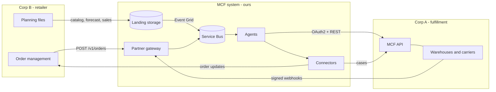

# Partner APIs: how Corp A, Corp B and the MCF system talk

The MCF system sits between two companies. In the dev environment both companies are simulated, but
each runs as its own service with its own identity and its own database, and talks to the system
only over HTTPS, exactly as a real partner would. Swapping a simulator for the real partner means
pointing a URL somewhere else and exchanging real credentials; no agent code changes.



## Credentials (Key Vault, seeded once by the deploy workflow)

| Secret | Who presents it | To whom |
|---|---|---|
| `mcf-client-id`, `mcf-client-secret` | MCF system | Corp A OAuth2 token endpoint |
| `partner-corpa-webhook-secret` | Corp A signs webhooks | MCF gateway verifies |
| `partner-corpb-api-key` | Corp B order management | MCF gateway (`X-Api-Key`) |
| `corpb-inbound-api-key` | MCF connectors | Corp B endpoints (`X-Api-Key`) |

To rotate one, set a new value in Key Vault; the system picks it up within five minutes and the
simulators on their next restart.

## Corp B to the MCF system

`POST {gateway}/v1/orders` with `X-Api-Key`. Body is a consumer order:

```json
{"order_id": "CB261007-4F2A1C", "placed_at": "2026-10-07T19:42:10+00:00", "delivery_promise_days": 3,
 "lines": [{"line_id": "1", "upc": "640000000008", "quantity": 1}],
 "consumer": {"name": "Ana Lopez", "email": "ana@example.com", "phone": "+1-555-0100",
              "address": {"line1": "12 Oak Ave", "city": "Denver", "state": "CO", "postal_code": "80202", "country": "US"}}}
```

`202` accepted, `401` bad key, `422` validation errors (listed). Resending the same `order_id` is safe.
Orders outside the pilot (UPC not in the catalog, or outside the US 48) are accepted here and then
rejected back to Corp B with reasons.

**Planning files** go to the landing container as `corpb/<type>/<date>-<id>.json`, each
`{"feed_type": ..., "generated_at": ..., "records": [...]}`:

| Type | When | Records |
|---|---|---|
| `catalog` | go-live, then on change | `upc`, `title`, `category`, `unit_cost` (defines the pilot scope; the system lists these items with Corp A) |
| `cold_start` | go-live | `upc`, `region` (`west`/`east`), `weekly_units` |
| `forecast` | an hour after go-live, then Mondays | `upc`, `region`, `week_start`, `units` (8 weeks ahead) |
| `sales` | Mondays | last week's actual `units` per `upc` and `region` |

Invalid records are quarantined and Corp B's data contact gets the list; valid ones are used.

## MCF system to Corp B

`POST {corpb}/oms/v1/events` (order management) and `POST {corpb}/corpb/v1/events` (other teams),
with `X-Api-Key`. Body: `{"event_id", "type", "payload", "occurred_at"}`. Types include
`order_rejected`, `tracking_update`, `delay`, `delivery_failed`, `reship`, `cancellation` and
`decant_counts`. Corp B answers `2xx`; anything else is retried, then dead-lettered.

## MCF system to Corp A (the MCF API)

`POST {corpa}/oauth2/token` with `grant_type=client_credentials`, `client_id`, `client_secret`
returns a bearer token valid for an hour. Then:

| Operation | Method and path |
|---|---|
| CreateFulfillmentOrder | `POST /mcf/v1/fulfillment-orders` (202; same id and items again is a no-op; different items 409) |
| GetFulfillmentOrder | `GET /mcf/v1/fulfillment-orders/{id}` (status, shipments, `estimatedArrivalDate`) |
| FulfillmentOrderStatus | `GET /mcf/v1/fulfillment-orders/{id}/status` |
| GetFulfillmentPreview | `POST /mcf/v1/fulfillment-orders/preview` |
| GetPackageTrackingDetail | `GET /mcf/v1/tracking/{packageNumber}` |
| CreateInboundShipmentPlan | `POST /mcf/v1/inbound/plans` (stock moves between nodes) |
| UpdateInboundShipment | `PUT /mcf/v1/inbound/shipments/{shipmentId}` |
| CreateFeedDocument | `POST /mcf/v1/feeds/documents` (`contentType: LISTINGS` activates items) |
| ApproveDistributionPlan | `POST /mcf/v1/distribution-plans/{planId}/approve` |
| CreateCase | `POST /mcf/v1/cases` (handoffs Corp A owns: carrier trace, reship, return intercept, cancellation, transfer, disposition) |

Errors are `{"errors": [{"code", "message"}]}`. Like any partner API it throttles (429), has bad
moments (503) and is occasionally slow; the integration layer retries those 1, 2, 4, 8, 16 seconds
apart and fails fast on 4xx.

## Corp A to the MCF system (webhooks)

`POST {gateway}/v1/mcf/notifications` with header
`X-MCF-Signature: t=<unix seconds>,v1=<hex HMAC-SHA256 of "<t>.<raw body>">`. Signatures older
than five minutes are refused. Body: `{"notificationId", "notificationType", "eventTime", "payload"}`.
Corp A retries until it gets a `2xx`, for up to 72 hours; duplicates are dropped by notification id.

| Type | Payload | Becomes |
|---|---|---|
| `ORDER_STATUS_CHANGE` | `sellerFulfillmentOrderId`, `status` (ACCEPTED, PROCESSING, PACKED, SHIPPED, OUT_FOR_DELIVERY, DELIVERED, CANCELLED, UNFULFILLABLE), `statusTime`, `estimatedArrivalDate` | order lifecycle; UNFULFILLABLE also opens an exception |
| `TRACKING_UPDATE` | package, carrier, tracking number, `status`, recent scan `events` | tracking to Corp B; LOST, UNDELIVERABLE and DAMAGED scans open exceptions |
| `INVENTORY_EVENTS` | `events`: receipt, pick, transfer, decant, adjustment, removal, physical_count | inventory ledger and reconciliation |
| `SHIPMENT_FACT` | per package: units, cost, ground or air, final-mile miles | reporting metrics |
| `DISPOSITION_STATUS` | `rec_id`, `status` (completed, failed) | disposition tracking |
| `HANDOFF_UPDATE` | `caseId`, `status` (ACKNOWLEDGED, COMPLETED), `result` | handoff tracking |

## How the simulated partners behave

Corp B places about 140 orders a day (setting `corpbOrdersPerDay`), busiest in the US evening;
1 to 3 lines each, about 30% with a 2-day promise, a few to Alaska, Hawaii or Puerto Rico and a
few for items outside the pilot. About 2% of forecast records are malformed.

Corp A accepts orders within minutes, packs within hours, ships before a 7 pm UTC cut-off by
ground when ground makes the promise and by air otherwise, and delivers on carrier transit times by
distance. About 4% of parcels run late, 1.5% need a second delivery attempt, 0.4% get lost and
0.3% are undeliverable and come back. Stock starts at about six weeks of demand in each FC and ten
in each inbound storage centre, vendor deliveries arrive Mondays, transfers take carrier days, a
nightly count of every position occasionally finds shrink (booked as an adjustment that morning),
and its ops team works cases within 1 to 18 hours, now and then later than promised.
