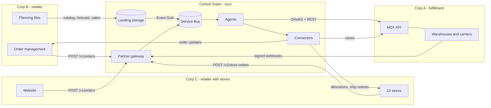

# Partner APIs: how Corp A, its retail clients and the Control Tower talk

The Control Tower sits between Corp A and the retailers it serves: Corp B (online only) and Corp C (a
website and twelve stores). In the dev environment every company is simulated, but each runs as its own service with its own identity and its own database, and talks to the system
only over HTTPS, exactly as a real partner would. Swapping a simulator for the real partner means
pointing a URL somewhere else and exchanging real credentials; no agent code changes.



## Credentials (Key Vault, seeded once by the deploy workflow)

| Secret | Who presents it | To whom |
|---|---|---|
| `mcf-client-id`, `mcf-client-secret` | Control Tower | Corp A OAuth2 token endpoint |
| `partner-corpa-webhook-secret` | Corp A signs webhooks | tower gateway verifies |
| `partner-corpb-api-key` | Corp B order management | tower gateway (`X-Api-Key`) |
| `corpb-inbound-api-key` | tower connectors | Corp B endpoints (`X-Api-Key`) |
| `partner-corpc-api-key` | Corp C website and stores | tower gateway (`X-Api-Key`) |
| `corpc-inbound-api-key` | tower connectors | Corp C endpoints (`X-Api-Key`) |

To rotate one, set a new value in Key Vault; the system picks it up within five minutes and the
simulators on their next restart.

## Corp B to the Control Tower

`POST {gateway}/v1/orders` with `X-Api-Key`. Body is a consumer order:

```json
{"order_id": "CB261007-4F2A1C", "placed_at": "2026-10-07T19:42:10+00:00", "delivery_promise_days": 3,
 "lines": [{"line_id": "1", "upc": "640000000008", "quantity": 1}],
 "consumer": {"name": "Ana Lopez", "email": "ana@example.com", "phone": "+1-555-0100",
              "address": {"line1": "12 Oak Ave", "city": "Denver", "state": "CO", "postal_code": "80202", "country": "US"}}}
```

`202` accepted, `401` bad key, `422` validation errors (listed). Resending the same `order_id` is safe.
Orders outside the pilot (UPC not in the catalog, or outside the US 48) are accepted here and then
rejected back to Corp B with reasons.

**Planning files** go to the landing container as `corpb/<type>/<date>-<id>.json`, each
`{"feed_type": ..., "generated_at": ..., "records": [...]}`:

| Type | When | Records |
|---|---|---|
| `catalog` | go-live, then on change | `upc`, `title`, `category`, `unit_cost` (defines the pilot scope; the system lists these items with Corp A) |
| `cold_start` | go-live | `upc`, `region` (`west`/`east`), `weekly_units` |
| `forecast` | an hour after go-live, then Mondays | `upc`, `region`, `week_start`, `units` (8 weeks ahead) |
| `sales` | Mondays | last week's actual `units` per `upc` and `region` |

Invalid records are quarantined and Corp B's data contact gets the list; valid ones are used.

## Control Tower to Corp B

`POST {corpb}/oms/v1/events` (order management) and `POST {corpb}/corpb/v1/events` (other teams),
with `X-Api-Key`. Body: `{"event_id", "type", "payload", "occurred_at"}`. Types include
`order_rejected`, `tracking_update`, `delay`, `delivery_failed`, `reship`, `cancellation` and
`decant_counts`. Corp B answers `2xx`; anything else is retried, then dead-lettered.

## Corp C to the Control Tower

Corp C's website sends consumer orders to `POST {gateway}/v1/orders` exactly as Corp B does (3-day promise
only). Its catalog goes to `corpc/catalog/`; each record also has `case_pack`. Its `cold_start`, `forecast`
and `sales` files follow Corp B's format under `corpc/<type>/`; its sales are last week's demand on Corp A's
network (web units plus store cases times case pack), by region. Each client's files are planned for that
client only, and records for another client's items are ignored. A daily `metrics_feed` event (the day's
metrics file) reaches Corp C with its order updates.

Its stores send replenishment orders to `POST {gateway}/v1/store-orders` with `X-Api-Key`, only allowed for
clients whose contract lists the `store` channel (else `403`):

```json
{"order_id": "CCS-ST-0101-261008", "placed_at": "2026-10-08T06:10:00+00:00",
 "store_id": "ST-0101", "store_name": "Corp C Seattle Northgate",
 "ship_to": {"line1": "401 NE Northgate Way", "city": "Seattle", "state": "WA", "postal_code": "98101", "country": "US"},
 "window_start": "2026-10-11", "window_end": "2026-10-14",
 "lines": [{"line_id": "1", "upc": "650000000012", "cases": 4, "case_pack": 6}]}
```

`422` when the window is backwards, ends sooner than the contract's `store_lead_days`, a line has no cases, or
line ids repeat. Corp A sees the order as `CORPC-<order_id>`.

**Allocation.** Web and store orders share Corp C's stock. Before a store order goes to Corp A, each line is cut
to what Corp C can spare: on hand across the network, minus units held by open orders, minus a web reserve
(the last 14 days' web demand per day times `online_protect_days`), in whole cases. The store hears the result
first as `store_order_allocated`; if no line gets a case the order is `order_rejected` with the numbers.

**Receiving.** When a delivery is unloaded, the store counts it against the ship notice and sends its
receiving report to `POST {gateway}/v1/store-receipts` (same key and `store` contract):

```json
{"receipt_id": "RCV-CCS-ST-0101-261008", "order_id": "CCS-ST-0101-261008", "store_id": "ST-0101",
 "asn_id": "ASN3F2A9C1B0D", "received_at": "2026-10-13T09:40:00+00:00",
 "lines": [{"upc": "650000000012", "expected_units": 24, "received_units": 18, "damaged_units": 0}]}
```

`received_units` counts everything off the truck, damaged units included. One line per item; an item that
arrived but is not on the notice has `expected_units` 0. A recount the tower asked for is a new report with
`recount_of` naming the first. `422` when lines repeat an item or damage exceeds what was received. A report that
matches the notice closes the delivery; any other opens a receiving claim (see Control Tower to Corp C).

## Consumer returns (both retailers)

`POST {gateway}/v1/returns` with `X-Api-Key`, from a client whose contract has `return_window_days` above 0:

```json
{"return_id": "RCB261007-4F2A1C", "order_id": "CB261007-4F2A1C", "requested_at": "2026-10-12T15:02:00+00:00",
 "lines": [{"line_id": "1", "upc": "640000000008", "quantity": 1, "reason": "damaged_in_transit"}]}
```

Reasons: `no_longer_needed`, `not_as_described`, `damaged_in_transit`, `defective`. `202` accepted, `422` validation.
The tower then answers on the client's `/oms/v1/events`:

| Type | When | Payload |
|---|---|---|
| `return_rejected` | the order is not delivered, outside the window, or the units were already returned | `reasons` |
| `return_authorized` | Corp A issued an RMA | `rma_id`, `label` (`carrier`, `trackingNumber`), `ship_by` |
| `return_update` | the parcel was picked up, then reached the returns bench | `status` (`in_transit`, `arrived`) |
| `return_received` | Corp A graded every unit | per line: `expected`, `grades`, `refund_units`, `held_units`, `holds` (units and why) |
| `return_expired` | no carrier scan ten days after `ship_by` | `rma_id`, `ship_by` |

Refund rule: sellable and defective units are refunded; damaged units only when the consumer reported damage in
transit. Unreported damage, a different item in the parcel and units missing from the parcel are held for the
client to review. The client issues the refund; the tower only says what arrived.

## Control Tower to Corp C

`POST {corpc}/oms/v1/events`, same envelope as Corp B. Store orders get `store_order_allocated` (per line:
`cases_ordered`, `cases_allocated`, `short_cases`, `available_units`, `web_reserve_units`),
`advance_ship_notice` (`asnId`, `carrier`, `proNumber`, `billOfLading`, `appointment`, `pallets`, and per line
`sellerSku`, `casesShipped`, `unitsShipped`) and `tracking_update` with `store_id`. Web orders get the same
updates as Corp B's.

A receiving report that does not match its notice is answered with `receipt_id`, `order_id`, `store_id` and:

| Type | When | Payload |
|---|---|---|
| `receipt_resolved` | the cause is settled | `outcome` (`credited` or `no_credit`), `cause`, `credit_usd`, or a `reason` |
| `receipt_recount_requested` | everything looks to have arrived; please count again | `reason` |
| `receipt_under_review` | a person at Corp A decides (unclear, or a large credit) | `reason` |

A credit shows on the client's next invoice as a negative "Credits for store deliveries short or damaged" line.
When the cause is the carrier's, Corp A also files a freight claim with the carrier (an operations case,
`freight_claim`).

## Control Tower to Corp A (the MCF API)

`POST {corpa}/oauth2/token` with `grant_type=client_credentials`, `client_id`, `client_secret`
returns a bearer token valid for an hour. Then:

| Operation | Method and path |
|---|---|
| CreateFulfillmentOrder | `POST /mcf/v1/fulfillment-orders` (202; same id and items again is a no-op; different items 409). Store orders add `orderType: B2B`, `shippingSpeedCategory: Freight`, `deliveryWindow {start, end}`, `casePack` per item and `storeId` on the address |
| GetFulfillmentOrder | `GET /mcf/v1/fulfillment-orders/{id}` (status, shipments, `estimatedArrivalDate`) |
| FulfillmentOrderStatus | `GET /mcf/v1/fulfillment-orders/{id}/status` |
| GetFulfillmentPreview | `POST /mcf/v1/fulfillment-orders/preview` |
| GetPackageTrackingDetail | `GET /mcf/v1/tracking/{packageNumber}` |
| CreateInboundShipmentPlan | `POST /mcf/v1/inbound/plans` (stock moves between nodes) |
| UpdateInboundShipment | `PUT /mcf/v1/inbound/shipments/{shipmentId}` |
| CreateFeedDocument | `POST /mcf/v1/feeds/documents` (`contentType: LISTINGS` activates items) |
| ApproveDistributionPlan | `POST /mcf/v1/distribution-plans/{planId}/approve` |
| CreateFulfillmentReturn | `POST /mcf/v1/returns` (`sellerFulfillmentOrderId`, `sellerReturnId`, items with `returnReasonCode`; 202 with `rmaId`, `returnToNode`, `label`, `shipBy`; delivered parcel orders only) |
| SetReturnDisposition | `POST /mcf/v1/returns/{rmaId}/disposition` (per graded item: `liquidate`, `return_to_vendor` or `hold_for_client`) |
| CreateCase | `POST /mcf/v1/cases` (handoffs Corp A owns: carrier trace, reship, return intercept, cancellation, transfer, disposition) |

Errors are `{"errors": [{"code", "message"}]}`. Like any partner API it throttles (429), has bad
moments (503) and is occasionally slow; the integration layer retries those 1, 2, 4, 8, 16 seconds
apart and fails fast on 4xx.

## Corp A to the Control Tower (webhooks)

`POST {gateway}/v1/mcf/notifications` with header
`X-MCF-Signature: t=<unix seconds>,v1=<hex HMAC-SHA256 of "<t>.<raw body>">`. Signatures older
than five minutes are refused. Body: `{"notificationId", "notificationType", "eventTime", "payload"}`.
Corp A retries until it gets a `2xx`, for up to 72 hours; duplicates are dropped by notification id.

| Type | Payload | Becomes |
|---|---|---|
| `ORDER_STATUS_CHANGE` | `sellerFulfillmentOrderId`, `status` (ACCEPTED, PROCESSING, PACKED, SHIPPED, OUT_FOR_DELIVERY, DELIVERED, CANCELLED, UNFULFILLABLE), `statusTime`, `estimatedArrivalDate` | order lifecycle; UNFULFILLABLE also opens an exception |
| `TRACKING_UPDATE` | package, carrier, tracking number, `status`, recent scan `events` | tracking to Corp B; LOST, UNDELIVERABLE and DAMAGED scans open exceptions |
| `INVENTORY_EVENTS` | `events`: receipt, pick, transfer, decant, adjustment, removal, physical_count | inventory ledger and reconciliation |
| `ADVANCE_SHIP_NOTICE` | store freight: `sellerFulfillmentOrderId`, `asnId`, carrier, PRO number, bill of lading, dock `appointment`, `pallets`, `lines` | `advance_ship_notice` to the client's store |
| `RETURN_STATUS` | `rmaId`, `sellerReturnId`, `status` (IN_TRANSIT, DELIVERED), carrier, tracking number | `return_update` to the client |
| `RETURN_RECEIVED` | `rmaId`, `sellerReturnId`, `nodeId`, `items` (`sellerSku`, `grade` SELLABLE, DAMAGED, DEFECTIVE or WRONG_ITEM, `quantity`) | refund decision and disposition; sellable units also arrive as an inventory receipt |
| `SHIPMENT_FACT` | per package: units, cost, ground, air or `ltl`, final-mile miles, pallets for freight | reporting metrics |
| `DISPOSITION_STATUS` | `rec_id`, `status` (completed, failed) | disposition tracking |
| `HANDOFF_UPDATE` | `caseId`, `status` (ACKNOWLEDGED, COMPLETED), `result` | handoff tracking |

## How the simulated partners behave

Corp B places about 140 orders a day (setting `corpbOrdersPerDay`), busiest in the US evening;
1 to 3 lines each, about 30% with a 2-day promise, a few to Alaska, Hawaii or Puerto Rico and a
few for items outside the pilot. About 2% of forecast records are malformed.

Corp A accepts orders within minutes, packs within hours, ships before a 7 pm UTC cut-off by
ground when ground makes the promise and by air otherwise, and delivers on carrier transit times by
distance. About 4% of parcels run late, 1.5% need a second delivery attempt, 0.4% get lost and
0.3% are undeliverable and come back. Stock starts at about six weeks of demand in each FC and ten
in each inbound storage centre, vendor deliveries arrive Mondays, transfers take carrier days, a
nightly count of every position occasionally finds shrink (booked as an adjustment that morning),
and its ops team works cases within 1 to 18 hours, now and then later than promised.

Store orders (B2B) ship whole cases from the region's inbound storage centre first, then the FCs; lines it
cannot fill are cut. Freight is booked a day ahead and goes LTL with a PRO number, 30 cases to a pallet, on
a dock appointment inside the store's window (about 6% arrive a day or two late). The ship notice goes out
when the truck leaves; delivery reads "Delivered to store receiving, POD signed clean".

Now and then a truckload goes wrong (`sim/common/freight.py`, decided from the ship notice so Corp A and the store
agree): about 2% carry a wrong case (one item's case swapped for another's on the same order), 2.5% leave a
case on the warehouse shelf, 2.5% arrive with a crushed case and 1.2% lose a case in the carrier's network.
Damage, and most losses, are noted on the proof of delivery; a case left behind or grabbed by mistake shows up
in Corp A's next nightly count and is booked as an adjustment that morning, like shrink. Separately, about 1%
of store counts are a case short when everything arrived (8% at two stores with new receiving staff); a recount
finds the case.

About 8% of Corp B's delivered web orders and 6% of Corp C's come back (settings `CORPB_RETURN_RATE`,
`CORPC_RETURN_RATE` on the simulators): one item, asked for half a day to twelve days after delivery, and 3% too
late. Corp A sends labels good for 14 days; 12% of consumers never ship. Parcels travel on ground transit times
to the region's FC and are graded within two days: by reason, mostly sellable for "no longer needed", mostly
damaged for "damaged in transit", mostly defective for "defective", with a few wrong items and empty boxes.

Corp C places about 60 web orders a day (`corpcWebOrdersPerDay`). Its twelve stores sell from their shelves
every day (about two thirds of Corp C's demand) and each orders once a week on its own weekday: every item
below one and a half weeks of cover is ordered up to three weeks, in whole cases, for delivery three to six
days out. Delivered cases go onto the store's shelves.
